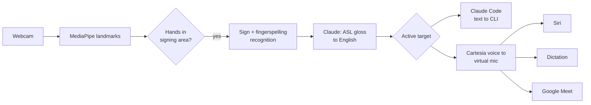

# calhacks-2026

> Working title. Product name TBD.

A webcam app that lets Deaf ASL signers use voice-first tools by signing. Sign to your webcam, and your signing becomes natural English that goes straight into Claude Code, or is spoken through a virtual microphone so you can use Siri, dictation, and Google Meet.

Built at Cal Hacks 13.0 (Oct 23–25, 2026).

## Why

Voice assistants, dictation, and AI tools are increasingly built around speech. For people whose first language is ASL, that means working in a second language or being left out. Our design rule is **parity**: give signers what voice users already have.

We're a hearing team, and we're building this with input from Deaf ASL faculty at the University of Washington. We plan to keep developing it after Cal Hacks based on their feedback.

## How it works



1. **Capture**: MediaPipe extracts hand, pose, and face landmarks from the webcam.
2. **Gating**: only hands raised into the signing area are read, so typing or resting hands don't trigger anything.
3. **Recognition**: an isolated-sign classifier plus a fingerspelling model turn landmarks into ASL gloss. Control signs (YES, NO, FINISH) confirm and send.
4. **Language**: Claude turns the gloss into fluent English.
5. **Output**: English goes to the active target. Claude Code gets text directly, after an ASL YES/NO confirm. Siri, dictation, and Meet get speech in a Cartesia voice through a virtual microphone (BlackHole on macOS).
6. **Captions in**: during Meet calls, incoming speech is shown as live captions for the signer (Cartesia speech-to-text).

## Features

| Feature | Status |
|---|---|
| Sign recognition + gloss to English | Planned (MVP) |
| Signed prompts and live edits in Claude Code | Planned (MVP) |
| Siri by sign | Planned (MVP) |
| Google Meet: speech out, captions in, "signing..." cue | Planned (MVP) |
| Signing-area gating | Planned (MVP) |
| App-switching signs | Planned (MVP) |
| ASL YES/NO confirm for Claude Code | Planned (MVP) |
| Tone from facial expressions | Stretch |
| Teach it your own signs | Stretch |
| Live accuracy and latency on screen | Stretch |

## Repo structure

```
recognition/   MediaPipe capture, signing-area gating, sign + fingerspelling models, mock recognizer
language/      Gloss-to-English with the LLM
outputs/       Router, Claude Code output, TTS + virtual mic, Meet captions
ui/            Native Mac app windows (PySide6): camera window with tracking overlay, and control window
shared/        SignEvent and Utterance types, event bus
```

The mock recognizer turns keyboard input into sign events, so the language, output, and UI pieces can be built and tested before real recognition is ready.

## Getting started

Requirements:
- macOS (Apple Silicon) with a webcam
- [uv](https://docs.astral.sh/uv/) (`brew install uv`); it installs Python 3.11 for you
- [BlackHole 2ch](https://github.com/ExistentialAudio/BlackHole) virtual audio driver, for speech into Siri, dictation, and Meet
- [Claude Code](https://docs.anthropic.com/en/docs/claude-code) CLI, installed and logged in
- An Anthropic API key (Claude) and a Cartesia API key (voice and captions)

```bash
git clone https://github.com/SacchinS/calhacks-2026.git
cd calhacks-2026
make install                      # uv sync: Python 3.11 + dependencies
make mock                         # opens both windows on mocks: no webcam, keys, or BlackHole
```

`make mock` opens two windows:
- **Camera window:** the webcam feed with the tracking overlay, recognized signs, the English, and the YES/NO prompt. For the demo, drag it to the second display and press `F` (or right-click > Move to display) to go fullscreen there; `Esc` leaves fullscreen. It remembers which display it was on.
- **Control window:** mode, status, `CLEAR` and `MODE` buttons, Claude Code's reply, what was spoken, and captions in Meet mode.

Type mock signs in the control window's "Mock signs" box (or in the terminal):
`me want fix bug login page`, then `/send`, then `/yes` or `/no`. `#word` is a fingerspelled word, `/mode` switches between Claude Code, voice, and Meet, and `/clear` starts over. Close the control window (or press Ctrl-C) to quit.

To use the real pieces:

```bash
brew install blackhole-2ch                  # then restart, or log out and back in
npm install -g @anthropic-ai/claude-code    # then run `claude` once to log in
cp .env.example .env                        # fill in ANTHROPIC_API_KEY and CARTESIA_API_KEY
uv sync --extra camera                      # MediaPipe + OpenCV for the webcam (Person A)
```

Choose each component in `config.yaml` (every default is the mock), then `make run`:

```yaml
recognizer: mock        # mock | replay | camera
translator: mock        # mock | claude
claude_code: mock       # mock | real
tts: mock               # mock | say | cartesia
captions: mock          # mock | cartesia
```

`recognizer: replay` plays `fixtures/landmarks_sample.jsonl`, so you don't need a webcam. `recognizer: camera` asks for camera permission the first time (allow it for your terminal app). With `tts: say` or `tts: cartesia`, select "BlackHole 2ch" as the microphone in Siri, dictation, or Meet. A component that isn't ready falls back to its mock or to the console, with a warning in the control window.

```bash
make test                         # unit, contract, and end-to-end tests (no real API calls)
uv run pytest --live              # also run real implementations (keys, BlackHole, webcam)
make lint                         # ruff check + format check
make app                          # build dist/calhacks-2026.app with PyInstaller (rough for now)
```

## Models and data

- [Kaggle ISLR 2023 1st-place model](https://huggingface.co/sign/kaggle-asl-signs-1st-place) (MIT license): isolated sign recognition, 250 signs
- Kaggle ASL Fingerspelling 2023 winning model: names and rare words
- [MediaPipe Model Maker](https://ai.google.dev/edge/mediapipe/solutions/model_maker): custom command signs

## Limitations

- Recognition covers a limited vocabulary, not all of ASL. ASL grammar, regional variation, and facial grammar are only partly handled.
- Live webcam accuracy can be much lower than benchmark scores. We'll report what we actually measure.
- "Hey Siri" can't be triggered through a virtual mic. Siri is started with a keyboard shortcut.
- macOS only for now.

## Acknowledgments

Thanks to the Deaf ASL faculty at UW for their time and feedback.
