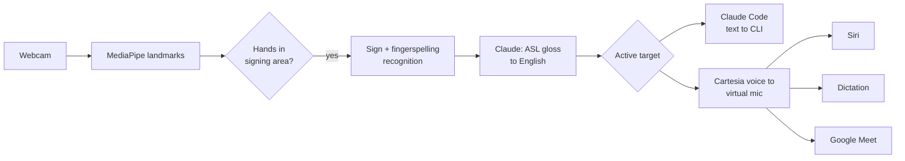

# calhacks-2026

> Working title. Product name TBD.

A webcam app that lets Deaf ASL signers use voice-first tools by signing. Sign to your webcam, and your signing becomes natural English that goes straight into Claude Code, or is spoken through a virtual microphone so you can use Siri, dictation, and Google Meet.

Built at Cal Hacks 13.0 (Oct 23–25, 2026).

## Why

Voice assistants, dictation, and AI tools are increasingly built around speech. For people whose first language is ASL, that means working in a second language or being left out. Our design rule is **parity**: give signers what voice users already have.

We're a hearing team, and we're building this with input from Deaf ASL faculty at the University of Washington. We plan to keep developing it after Cal Hacks based on their feedback.

## How it works



1. **Capture**: MediaPipe extracts hand, pose, and face landmarks from the webcam.
2. **Gating**: only hands raised into the signing area are read, so typing or resting hands don't trigger anything.
3. **Recognition**: an isolated-sign classifier plus a fingerspelling model turn landmarks into ASL gloss. Control signs (YES, NO, FINISH) confirm and send.
4. **Language**: Claude turns the gloss into fluent English.
5. **Output**: English goes to the active target. Claude Code gets text directly, after an ASL YES/NO confirm. Siri, dictation, and Meet get speech in a Cartesia voice through a virtual microphone (BlackHole on macOS).
6. **Captions in**: during Meet calls, incoming speech is shown as live captions for the signer (Cartesia speech-to-text).

## Features

| Feature | Status |
|---|---|
| Sign recognition + gloss to English | Planned (MVP) |
| Signed prompts and live edits in Claude Code | Planned (MVP) |
| Siri by sign | Planned (MVP) |
| Google Meet: speech out, captions in, "signing..." cue | Planned (MVP) |
| Signing-area gating | Planned (MVP) |
| App-switching signs | Planned (MVP) |
| ASL YES/NO confirm for Claude Code | Planned (MVP) |
| Tone from facial expressions | Stretch |
| Teach it your own signs | Stretch |
| Live accuracy and latency on screen | Stretch |

## Repo structure

```
recognition/   MediaPipe capture, signing-area gating, sign + fingerspelling models, mock recognizer
language/      Gloss-to-English with the LLM
outputs/       Router, Claude Code output, TTS + virtual mic, Meet captions
ui/            Signer-facing overlay and demo screens
shared/        SignEvent and Utterance types, event bus
```

The mock recognizer turns keyboard input into sign events, so the language, output, and UI pieces can be built and tested before real recognition is ready.

## Getting started

> TODO: fill in once the stack is set up.

Requirements (planned):
- macOS with a webcam
- [BlackHole](https://github.com/ExistentialAudio/BlackHole) virtual audio driver
- [Claude Code](https://docs.anthropic.com/en/docs/claude-code) CLI
- An Anthropic API key (Claude) and a Cartesia API key (voice and captions)

```bash
git clone <repo-url>
cd calhacks-2026
# install + run steps TBD
```

## Models and data

- [Kaggle ISLR 2023 1st-place model](https://huggingface.co/sign/kaggle-asl-signs-1st-place) (MIT license): isolated sign recognition, 250 signs
- Kaggle ASL Fingerspelling 2023 winning model: names and rare words
- [MediaPipe Model Maker](https://ai.google.dev/edge/mediapipe/solutions/model_maker): custom command signs

## Limitations

- Recognition covers a limited vocabulary, not all of ASL. ASL grammar, regional variation, and facial grammar are only partly handled.
- Live webcam accuracy can be much lower than benchmark scores. We'll report what we actually measure.
- "Hey Siri" can't be triggered through a virtual mic. Siri is started with a keyboard shortcut.
- macOS only for now.

## Acknowledgments

Thanks to the Deaf ASL faculty at UW for their time and feedback.
