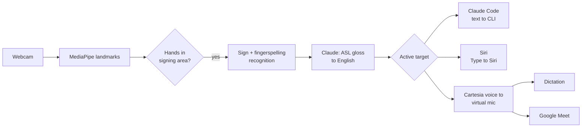

# calhacks-2026

> Working title. Product name TBD.

A webcam app that lets Deaf ASL signers use voice-first tools by signing. Sign to your webcam, and your signing becomes natural English that goes straight into Claude Code, is typed to Siri, or is spoken through a virtual microphone so you can use dictation and Google Meet.

Built at Cal Hacks 13.0 (Oct 23–25, 2026).

## Why

Voice assistants, dictation, and AI tools are increasingly built around speech. For people whose first language is ASL, that means working in a second language or being left out. Our design rule is **parity**: give signers what voice users already have.

We're a hearing team, and we're building this with input from Deaf ASL faculty at the University of Washington. Professor Lance Forshay told us video calls are where he'd use it, that hearing people often hang up on relay calls because they don't know who's calling, and that accuracy, privacy, and "government recording" would stop him trusting a tool like this. So calls are the center of the app, every call starts by saying who's calling, and video never leaves the laptop. His answers are in [`docs/user-research.md`](docs/user-research.md). We plan to keep developing it after Cal Hacks with Deaf testers.

## How it works



1. **Capture**: MediaPipe extracts hand, pose, and face landmarks from the webcam.
2. **Gating**: only hands raised into the signing area are read, so typing or resting hands don't trigger anything.
3. **Recognition**: the Kaggle ISLR 1st-place model (250 signs) plus custom signs we record ourselves (a few examples each, matched on hand shape and movement) turn landmarks into ASL gloss. Facial grammar (raised or furrowed brows, head shakes and nods) can be added as tags, off by default until a Deaf signer has checked it. Control signs (YES, NO, and a held FINISH) confirm and send.
4. **Language**: Claude turns the gloss into fluent English.
5. **Output**: English goes to the active target. Claude Code gets text directly, after an ASL YES/NO confirm. Siri gets the question typed in with Type to Siri: the app holds ⌘Space to open Siri and types it. Dictation and Meet get speech in a Cartesia voice through a virtual microphone (BlackHole on macOS).
6. **Captions in**: during Meet calls, incoming speech is shown as live captions for the signer (Cartesia speech-to-text).

## Features

| Feature | Status |
|---|---|
| Sign recognition (Kaggle model + custom signs) | Built; needs tuning on a live webcam |
| Gloss to English with Claude | Built; needs an API key to run |
| Signed prompts and live edits in Claude Code | Works (tested with typed signs: a build, then a re-prompt in the same session) |
| Claude Code builds in the background while you use Siri and Meet | Works |
| Siri by sign (Type to Siri) | Works |
| Google Meet: Cartesia voice out, captions in, "One moment, I'm signing." cue | Built; needs a Cartesia key and BlackHole 16ch to test |
| Call intro: says who's calling ("Introduce me"; automatic only with `meet.intro_on_start`, for calls with strangers) | Built |
| Turn-aware speaking: waits for the other person to finish, or politely jumps in | Works (tested with Cartesia Ink on a loopback) |
| Quick replies in calls ("Can you repeat that?", "Please slow down a little.", "Yes."...) | Built; urgent ones are said right away |
| Mention alerts: a flashing banner over every window when someone says your name or asks you something | Built |
| Video stays on the laptop, camera-on indicator | Built |
| Review the English before it's spoken in Meet | Built (off by default) |
| Signing-area gating, fitted to the signer in setup | Built |
| ASL YES/NO confirm for Claude Code | Works |
| Teach it your own signs (`tools/record_signs.py`) | Built |
| Facial grammar tags (brows, head shake, nod) | Built, off by default |
| Fingerspelling | Not yet: no released Kaggle winner model we can download |
| App-switching signs | Not yet: the mode picker is in the app |
| Live accuracy and latency on screen | Stretch |

## Repo structure

```
recognition/   MediaPipe capture, signing-area gating, Kaggle sign model, custom signs, face markers, mock recognizer
language/      Gloss-to-English with Claude (prompt in language/prompts/)
outputs/       Router, Claude Code, Type to Siri, Cartesia voice into the virtual mic, Meet call intro
captions/      Meet captions with Cartesia speech-to-text
ui/            Mac menu-bar app (SwiftUI, from SignBridge): Demo Mode, Preview, setup; server.py bridges it to the engine
shared/        SignEvent and Utterance types, event bus
demo/site/     The starting folder for the website Claude Code builds in the demo
tools/         Record custom signs and landmark fixtures; reset and serve the demo site
```

The mock recognizer turns keyboard input into sign events, so the language, output, and UI pieces can be built and tested before real recognition is ready.

## Getting started

Teammates: start with [`HANDOFF.md`](HANDOFF.md).

Requirements:
- macOS 14+ (Apple Silicon) with a webcam
- Xcode or the Xcode command-line tools (`xcode-select --install`), for the Swift app
- [uv](https://docs.astral.sh/uv/) (`brew install uv`); it installs Python 3.11 for you
- [BlackHole 2ch](https://github.com/ExistentialAudio/BlackHole) virtual audio driver, for speech into dictation and Meet
- [Claude Code](https://docs.anthropic.com/en/docs/claude-code) CLI, installed and logged in
- An Anthropic API key (Claude) and a Cartesia API key (voice and captions)

```bash
git clone https://github.com/SacchinS/calhacks-2026.git
cd calhacks-2026
make install                      # uv sync: Python 3.11 + dependencies
make mock                         # builds and opens the Mac app on mocks: no webcam, keys, or BlackHole
```

The app is SignBridge's SwiftUI app (`ui/macos`); it starts the Python engine (`app.py`) itself and lives in the menu bar (the hand icon).
- **First launch** opens the setup wizard. Click through it ("Skip for now" is fine with mocks); after that the app opens the **Preview** window.
- **Preview:** the camera with tracking, the signs, the English, and the confirm step. Pick where English goes (Claude Code, Siri, Voice, or Meet) at the top. With the mock recognizer, type signs in the box at the bottom (or in the terminal): `me want fix bug login page`, then `/send`, then `/yes` or `/no`. `#word` is fingerspelled, `/clear` starts over. Face markers go after the signs they cover: `title /\ red` (raised brows, topic), `tomorrow rain [q]` (yes/no question), `[wh]`, `[neg]`, `[nod]`. The Send / Cancel buttons do the same as signing YES / NO.
- **Demo Mode** (Preview > Demo, or the menu bar) is the fullscreen stage for the second display. Menu bar > Demo Mode On picks the display; it remembers it. Esc leaves it. Backup keys: W start, C send (YES), X cancel (NO), 1–6 the demo script's phrases in order (the same list is under Preview > Test phrases).
- Quit from the menu bar. Engine logs go to the terminal under `make mock`, and to `~/Library/Logs/calhacks-2026/engine.log` in the packaged app.

To use the real pieces:

```bash
brew install blackhole-2ch                  # then restart, or log out and back in
npm install -g @anthropic-ai/claude-code    # then run `claude` once to log in
cp .env.example .env                        # fill in ANTHROPIC_API_KEY and CARTESIA_API_KEY
uv sync --extra camera                      # MediaPipe + OpenCV for the webcam (Person A)
```

For the live demo, `make demo` runs every real component (`config.demo.yaml` on top of `config.yaml`). To pick components one at a time, set them in `config.yaml` (every default is the mock, and `main` keeps it that way), then `make run`:

```yaml
recognizer: mock        # mock | replay | camera
translator: mock        # mock | claude
claude_code: mock       # mock | real
siri: mock              # mock | real
tts: mock               # mock | say | cartesia
captions: mock          # mock | cartesia
```

`recognizer: replay` plays `fixtures/landmarks_sample.jsonl`, so you don't need a webcam (its preview needs `uv sync --extra camera`). `recognizer: camera` asks for camera permission the first time (allow it for your terminal app). `siri: real` types the English into Siri. It needs Siri's keyboard shortcut set to Hold Command Space (System Settings > Apple Intelligence & Siri), Type to Siri turned on (Accessibility > Siri), and Accessibility permission for the app (or your terminal, with `make run`). Check the shortcut first: with the default shortcut, Cmd-Space opens Spotlight instead. With `tts: say` or `tts: cartesia`, select "BlackHole 2ch" as the microphone in dictation or Meet. A component that isn't ready falls back to its mock or to the console, with a note in the Preview window.

**Audio for Meet.** Our voice goes into BlackHole 2ch; the other side's voice has to reach a *different* device for captions, or we'd caption ourselves:
1. `brew install blackhole-16ch` (then restart).
2. Audio MIDI Setup > + > Create Multi-Output Device: tick your speakers or headphones and BlackHole 16ch.
3. In Meet's settings: Microphone = BlackHole 2ch, Speakers = that Multi-Output Device.
4. `config.yaml`: `audio.virtual_mic_device: BlackHole 2ch`, `audio.meet_capture_device: BlackHole 16ch` (the defaults).

**The demo website.** `make demo-reset` copies `demo/site` to `claude_code_cli.project_dir` (`../demo-site`; an old copy is kept as a backup) and starts a fresh Claude Code session there. `make demo-serve` serves it at http://localhost:8765 and reloads the page whenever Claude Code changes a file. Claude Code runs headless in that folder with `--permission-mode acceptEdits` and only file tools (`Read,Edit,Write,Glob,Grep`), and every request after the first continues the same session with `--resume`.

**Custom signs.** Demo signs the Kaggle model doesn't know (`WW`, `YOU-REMIND-ME`, `MEET-YOU`, `BUY`, `HOW`, `YOU`, `TITLE`) are recorded from a few examples each: `uv run python tools/record_signs.py WW --takes 5`, then `--check` to see whether the signs separate. Learn each sign from a Deaf signer or the videos linked in `docs/asl-demo-script-research.md` first.

**Calls.** In the app's Settings > Calls, set your name for the call intro ("Hi, this is Sam. I'm Deaf and signing through SignBridge...", said when Meet mode starts; Preview's Meet panel has "Introduce me" to say it again) and turn on "Review before speaking" if Meet and Voice should wait for YES.

```bash
make test                         # unit, contract, and end-to-end tests (no real API calls)
uv run pytest --live              # also run real implementations (keys, BlackHole, webcam)
make lint                         # ruff check + format check
make app                          # build dist/SignBridge.app (Swift app + bundled Python engine)
```

The packaged app reads its keys from `~/Library/Application Support/calhacks-2026/.env`, and a `config.yaml` there if you put one (the bundled one is all mocks; use absolute paths for `claude_code_cli.project_dir` and `recognition.custom_signs_dir`). Keys are never copied into the bundle.

## Models and data

- [Kaggle ISLR 2023 1st-place model](https://huggingface.co/sign/kaggle-asl-signs-1st-place) (MIT license): isolated sign recognition, 250 signs. Downloaded to `models/islr/` the first time the camera runs; run with LiteRT.
- [MediaPipe Holistic Landmarker](https://ai.google.dev/edge/mediapipe/solutions/vision/holistic_landmarker): hand, pose, and face landmarks.
- Custom signs: our own recordings (landmarks only), matched by nearest neighbour.

## How we use Claude

- **Translation.** Claude (Haiku 5.5, for speed) turns ASL gloss into English with the prompt in `language/prompts/gloss_to_english.md`: ASL grammar (topic first, time first, no articles), our custom signs (`WW` = website), facial grammar tags (`[yes/no question]`, `[negation]`), and how each target wants it (a direct instruction for Claude Code, a plain request for Siri). Claude only ever sees the recognized sign words, as text: never video.
- **Claude Code.** In Claude Code mode, the signer's English becomes a request to Claude Code, run headless in the demo project folder. Its reply streams into the app, it builds in the background while the signer keeps using Siri and Meet, and a follow-up continues the same session, so the signer can build something and then change it, all by signing.
- **Where it can go wrong, and what we do about it.** A mistranslation is sent or spoken in a Deaf person's name, so the signer sees the English before anything happens: Claude Code waits for a signed YES (NO discards it), and Meet and Voice can wait too ("Review before speaking"). Claude Code is limited to file tools in one folder (`acceptEdits`, no shell, no extra directories), so a misread request can't touch anything else. If the translator fails, the app says so and falls back instead of guessing.

## Cartesia features we use

- **Sonic text-to-speech** (`outputs/tts_cartesia.py`): the signer's English is spoken in a Cartesia voice, streamed over the SSE endpoint as raw PCM and played into the virtual microphone (BlackHole 2ch) as it arrives, so the other side of a Meet call hears it with little delay. It also speaks the call intro and the "One moment, I'm signing." cue. If Cartesia fails, the app warns and uses macOS `say`.
- **Ink speech-to-text** (`captions/cartesia_stt.py`): the other side's call audio, captured from a separate device (BlackHole 16ch), is streamed to Cartesia's realtime STT websocket with turn detection; partial transcripts update the caption live and the end of each turn finalizes it.
- **Ink turn detection for turn-taking** (`outputs/turn_taking.py`): Ink's `turn.start`, `turn.eager_end`, `turn.resume`, and `turn.end` events tell our voice whether the other person has the floor. The signer's approved sentence waits for the end of their turn and is spoken the moment it comes; if they keep talking for 8 seconds, SignBridge says "Sorry, can I jump in?" first; if someone talks over our voice for more than a second, it stops and says the sentence again at the next pause. It changes when the words are spoken, never what they are.
- Only the English to speak and the other side's call audio go to Cartesia; nothing is saved.

## Privacy

- Our app never sends video anywhere. Hand tracking and sign recognition run on your Mac. (If your camera is on in a Meet call, Google Meet sends that video as usual.)
- Claude receives only the recognized sign words, as text. Cartesia receives only the final English to speak, plus the other side's call audio for captions.
- Each target gets the English you send it: Claude Code (which also reads the files in its project folder, and sends them to Anthropic), Siri (Apple), or the Meet call.
- To type to Siri, the app puts the question on the clipboard for a moment, then restores what was there. With Universal Clipboard on, your other Apple devices may briefly see it.
- Nothing is recorded or saved: no video, no transcripts. Logs never contain what you sign or say. (Custom signs you record yourself are saved on your Mac as landmark coordinates, not images, in `models/custom_signs/`.)
- The app always shows when the camera is on.

## Limitations

- Recognition covers a limited vocabulary (250 Kaggle signs plus the custom signs we record), not all of ASL. Fingerspelling isn't recognized yet. ASL grammar and regional variation are only partly handled.
- ASL grammar lives partly on the face and body. We can read brow raises and furrows, head shakes, and nods (off by default until a Deaf signer has checked it), but not mouth morphemes (size and intensity, like CHA or OOO) or body shifts (comparison, role shift), so some meaning is lost. A Deaf signer should check the output.
- Live webcam accuracy can be much lower than benchmark scores. We'll report what we actually measure.
- Siri can't be reached through a virtual mic. "Hey Siri" doesn't trigger from one, and even with Siri opened by ⌘Space and BlackHole set as the Mac's input, voice Siri ignores it (tested on macOS 26.2: BlackHole carried the audio, Siri heard nothing; it listens to the built-in mic). Siri uses the Type to Siri accessibility feature instead: set Siri's keyboard shortcut to Hold Command Space (Apple Intelligence & Siri settings), turn on Type to Siri (Accessibility > Siri), and give the app Accessibility permission so it can hold ⌘Space and type the question.
- It's not a replacement for a qualified interpreter. It's a direct option for short calls and voice-only tools.
- macOS only for now.

## Acknowledgments

Thanks to the Deaf ASL faculty at UW for their time and feedback, especially Professor Lance Forshay.
