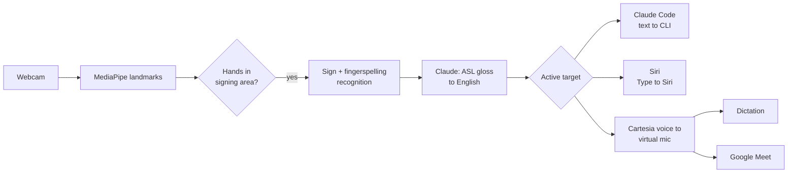

# calhacks-2026

> Working title. Product name TBD.

A webcam app that lets Deaf ASL signers use voice-first tools by signing. Sign to your webcam, and your signing becomes natural English that goes straight into Claude Code, is typed to Siri, or is spoken through a virtual microphone so you can use dictation and Google Meet.

Built at Cal Hacks 13.0 (Oct 23–25, 2026).

## Why

Voice assistants, dictation, and AI tools are increasingly built around speech. For people whose first language is ASL, that means working in a second language or being left out. Our design rule is **parity**: give signers what voice users already have.

We're a hearing team, and we're building this with input from Deaf ASL faculty at the University of Washington. Professor Lance Forshay told us video calls are where he'd use it, that hearing people often hang up on relay calls because they don't know who's calling, and that accuracy, privacy, and "government recording" would stop him trusting a tool like this. So calls come first, every call starts by saying who's calling, and video never leaves the laptop. His answers are in [`docs/user-research.md`](docs/user-research.md). We plan to keep developing it after Cal Hacks with Deaf testers.

## How it works



1. **Capture**: MediaPipe extracts hand, pose, and face landmarks from the webcam.
2. **Gating**: only hands raised into the signing area are read, so typing or resting hands don't trigger anything.
3. **Recognition**: an isolated-sign classifier plus a fingerspelling model turn landmarks into ASL gloss. Control signs (YES, NO, FINISH) confirm and send.
4. **Language**: Claude turns the gloss into fluent English.
5. **Output**: English goes to the active target. Claude Code gets text directly, after an ASL YES/NO confirm. Siri gets the question typed in with Type to Siri: the app holds ⌘Space to open Siri and types it. Dictation and Meet get speech in a Cartesia voice through a virtual microphone (BlackHole on macOS).
6. **Captions in**: during Meet calls, incoming speech is shown as live captions for the signer (Cartesia speech-to-text).

## Features

| Feature | Status |
|---|---|
| Sign recognition + gloss to English | Planned (MVP) |
| Signed prompts and live edits in Claude Code | Planned (MVP) |
| Siri by sign | Planned (MVP) |
| Google Meet: speech out, captions in, "signing..." cue | Planned (MVP) |
| Call intro: says who's calling at the start of a call | Planned (MVP) |
| Video stays on the laptop, camera-on indicator | Planned (MVP) |
| Review the English before it's spoken in Meet | Planned (MVP) |
| Signing-area gating | Planned (MVP) |
| App-switching signs | Planned (MVP) |
| ASL YES/NO confirm for Claude Code | Planned (MVP) |
| Tone from facial expressions | Stretch |
| Teach it your own signs | Stretch |
| Live accuracy and latency on screen | Stretch |

## Repo structure

```
recognition/   MediaPipe capture, signing-area gating, sign + fingerspelling models, mock recognizer
language/      Gloss-to-English with the LLM
outputs/       Router, Claude Code output, TTS + virtual mic, Meet captions
ui/            Mac menu-bar app (SwiftUI, from SignBridge): Demo Mode, Preview, setup; server.py bridges it to the engine
shared/        SignEvent and Utterance types, event bus
```

The mock recognizer turns keyboard input into sign events, so the language, output, and UI pieces can be built and tested before real recognition is ready.

## Getting started

Requirements:
- macOS 14+ (Apple Silicon) with a webcam
- Xcode or the Xcode command-line tools (`xcode-select --install`), for the Swift app
- [uv](https://docs.astral.sh/uv/) (`brew install uv`); it installs Python 3.11 for you
- [BlackHole 2ch](https://github.com/ExistentialAudio/BlackHole) virtual audio driver, for speech into dictation and Meet
- [Claude Code](https://docs.anthropic.com/en/docs/claude-code) CLI, installed and logged in
- An Anthropic API key (Claude) and a Cartesia API key (voice and captions)

```bash
git clone https://github.com/SacchinS/calhacks-2026.git
cd calhacks-2026
make install                      # uv sync: Python 3.11 + dependencies
make mock                         # builds and opens the Mac app on mocks: no webcam, keys, or BlackHole
```

The app is SignBridge's SwiftUI app (`ui/macos`); it starts the Python engine (`app.py`) itself and lives in the menu bar (the hand icon).
- **First launch** opens the setup wizard. Click through it ("Skip for now" is fine with mocks); after that the app opens the **Preview** window.
- **Preview:** the camera with tracking, the signs, the English, and the confirm step. Pick where English goes (Claude Code, Siri, Voice, or Meet) at the top. With the mock recognizer, type signs in the box at the bottom (or in the terminal): `me want fix bug login page`, then `/send`, then `/yes` or `/no`. `#word` is fingerspelled, `/clear` starts over. The Send / Cancel buttons do the same as signing YES / NO.
- **Demo Mode** (Preview > Demo, or the menu bar) is the fullscreen stage for the second display. Menu bar > Demo Mode On picks the display; it remembers it. Esc leaves it. Backup keys: W start, C send (YES), X cancel (NO), 1–6 test phrases.
- Quit from the menu bar. Engine logs go to the terminal under `make mock`, and to `~/Library/Logs/calhacks-2026/engine.log` in the packaged app.

To use the real pieces:

```bash
brew install blackhole-2ch                  # then restart, or log out and back in
npm install -g @anthropic-ai/claude-code    # then run `claude` once to log in
cp .env.example .env                        # fill in ANTHROPIC_API_KEY and CARTESIA_API_KEY
uv sync --extra camera                      # MediaPipe + OpenCV for the webcam (Person A)
```

Choose each component in `config.yaml` (every default is the mock), then `make run`:

```yaml
recognizer: mock        # mock | replay | camera
translator: mock        # mock | claude
claude_code: mock       # mock | real
siri: mock              # mock | real
tts: mock               # mock | say | cartesia
captions: mock          # mock | cartesia
```

`recognizer: replay` plays `fixtures/landmarks_sample.jsonl`, so you don't need a webcam (its preview needs `uv sync --extra camera`). `recognizer: camera` asks for camera permission the first time (allow it for your terminal app). `siri: real` types the English into Siri. It needs Siri's keyboard shortcut set to Hold Command Space (System Settings > Apple Intelligence & Siri), Type to Siri turned on (Accessibility > Siri), and Accessibility permission for the app (or your terminal, with `make run`). Check the shortcut first: with the default shortcut, Cmd-Space opens Spotlight instead. With `tts: say` or `tts: cartesia`, select "BlackHole 2ch" as the microphone in dictation or Meet. A component that isn't ready falls back to its mock or to the console, with a note in the Preview window.

```bash
make test                         # unit, contract, and end-to-end tests (no real API calls)
uv run pytest --live              # also run real implementations (keys, BlackHole, webcam)
make lint                         # ruff check + format check
make app                          # build dist/SignBridge.app (Swift app + bundled Python engine)
```

## Models and data

- [Kaggle ISLR 2023 1st-place model](https://huggingface.co/sign/kaggle-asl-signs-1st-place) (MIT license): isolated sign recognition, 250 signs
- Kaggle ASL Fingerspelling 2023 winning model: names and rare words
- [MediaPipe Model Maker](https://ai.google.dev/edge/mediapipe/solutions/model_maker): custom command signs

## Privacy

- Video never leaves your Mac. Hand tracking and sign recognition run on the device.
- Claude receives only the recognized sign words, as text. Cartesia receives only the final English to speak, plus the other side's call audio for captions.
- Nothing is recorded or saved: no video, no transcripts.
- The app always shows when the camera is on.

## Limitations

- Recognition covers a limited vocabulary, not all of ASL. ASL grammar, regional variation, and facial grammar are only partly handled.
- Live webcam accuracy can be much lower than benchmark scores. We'll report what we actually measure.
- Siri can't be reached through a virtual mic. "Hey Siri" doesn't trigger from one, and even with Siri opened by ⌘Space and BlackHole set as the Mac's input, voice Siri ignores it (tested on macOS 26.2: BlackHole carried the audio, Siri heard nothing; it listens to the built-in mic). Siri uses the Type to Siri accessibility feature instead: set Siri's keyboard shortcut to Hold Command Space (Apple Intelligence & Siri settings), turn on Type to Siri (Accessibility > Siri), and give the app Accessibility permission so it can hold ⌘Space and type the question.
- It's not a replacement for a qualified interpreter. It's a direct option for short calls and voice-only tools.
- macOS only for now.

## Acknowledgments

Thanks to the Deaf ASL faculty at UW for their time and feedback, especially Professor Lance Forshay.
