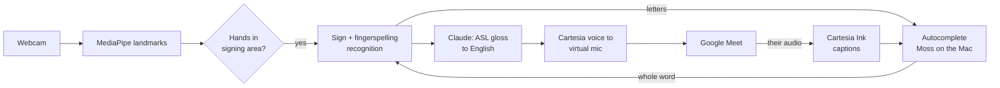

# calhacks-2026

> Working title. Product name TBD.

A Mac app that lets Deaf ASL signers take part in Google Meet calls by signing. Sign to your webcam, and your signing is spoken in the call as natural English through a virtual microphone; what the others say comes back as live captions. Names and jargon, which signers fingerspell letter by letter, are suggested after the first few letters by an autocomplete that learns the words used in your calls.

Built at Cal Hacks 13.0 (Oct 23–25, 2026).

## Why

Meetings are built around speech. For people whose first language is ASL, that means booking an interpreter, typing in the chat while everyone else talks, or being left out. Our design rule is **parity**: give signers what speaking participants already have.

We're a hearing team, and we're building this with input from Deaf ASL faculty at the University of Washington. Professor Lance Forshay told us video calls are where he'd use it, that hearing people often hang up on relay calls because they don't know who's calling, and that accuracy, privacy, and "government recording" would stop him trusting a tool like this. So the app is only about calls, it can say who's calling, and video never leaves the laptop. His answers are in [`docs/user-research.md`](docs/user-research.md). We plan to keep developing it after Cal Hacks with Deaf testers.

## How it works



1. **Capture**: MediaPipe extracts hand, pose, and face landmarks from the webcam.
2. **Gating**: only hands raised into the signing area are read, so typing or resting hands don't trigger anything.
3. **Recognition**: the Kaggle ISLR 1st-place model (250 signs) plus custom signs we record ourselves (a few examples each, matched on hand shape and movement) turn landmarks into ASL gloss. Fingerspelled letters go to the autocomplete, which suggests the whole word. Facial grammar (raised or furrowed brows, head shakes and nods) can be added as tags, off by default until a Deaf signer has checked it. Control signs (YES, NO, and a held FINISH) accept and send.
4. **Language**: Claude turns the gloss into fluent English.
5. **Voice out**: the English is spoken in the call in a Cartesia voice through a virtual microphone (BlackHole on macOS), at the next pause in the conversation. "Review before speaking" makes it wait for a signed YES first.
6. **Captions in**: the other side's speech is shown as live captions for the signer (Cartesia speech-to-text). Names and jargon in it are remembered for the autocomplete, and a banner flashes when someone says the signer's name.

## Features

| Feature | Status |
|---|---|
| Sign recognition | The demo uses our signer's recorded custom signs (HELLO, NICE, MEET, YOU, YES, FINISH: five takes each). ASL Citizen and Kaggle models are built but didn't recognize our signer live |
| Gloss to English with Claude | Works (live tests pass, under 1 s) |
| Google Meet: Cartesia voice out, captions in, "One moment, I'm signing." cue | Works on a loopback; a real two-laptop call is next |
| Call intro: says who's calling ("Introduce me"; automatic only with `meet.intro_on_start`, for calls with strangers) | Built |
| Turn-aware speaking: waits for the other person to finish, or politely jumps in | Works (tested with Cartesia Ink on a loopback) |
| Quick replies in calls ("Can you repeat that?", "Please slow down a little.", "Yes."...) | Built; urgent ones are said right away |
| Mention alerts: a flashing banner over every window when someone says your name or asks you something | Built |
| Video stays on the laptop, camera-on indicator | Built |
| Review the English before it's spoken | Built (off by default) |
| Signing-area gating, fitted to the signer in setup | Built |
| Teach it your own signs (`tools/record_signs.py`) | Built |
| Facial grammar tags (brows, head shake, nod) | Built, off by default |
| Fingerspelling autocomplete with Moss: suggests the word from the first letters, the conversation, and your history | Built and tested with typed letters; needs Moss keys for the Moss search |
| Fingerspelling recognition from the camera | Built (a letter model on the hand landmarks, A–Z without J and Z); not yet tried on a live webcam. Typed letters still work |
| Live accuracy and latency on screen | Stretch |

## Repo structure

```
recognition/   MediaPipe capture, signing-area gating, Kaggle sign model, custom signs, face markers, mock recognizer
language/      Gloss-to-English with Claude (prompt in language/prompts/), fingerspelling autocomplete and its word memory
outputs/       Router, Cartesia voice into the virtual mic, turn-taking, call intro
captions/      Meet captions with Cartesia speech-to-text, mention alerts
ui/            Mac menu-bar app (SwiftUI, from SignBridge): Demo Mode, Preview, setup; server.py bridges it to the engine
shared/        SignEvent and Utterance types, event bus
tools/         Record custom signs, demo takes and landmark fixtures; tune recognition; seed the word memory
```

The mock recognizer turns keyboard input into sign events, so the language, output, and UI pieces can be built and tested before real recognition is ready.

An earlier version also sent signed requests to Claude Code and typed questions to Siri. That's on the `archive/claude-code-siri` branch; `main` is Meet only.

## Getting started

Teammates: start with [`HANDOFF.md`](HANDOFF.md).

Requirements:
- macOS 14+ (Apple Silicon) with a webcam
- Xcode or the Xcode command-line tools (`xcode-select --install`), for the Swift app
- [uv](https://docs.astral.sh/uv/) (`brew install uv`); it installs Python 3.11 for you
- [BlackHole](https://github.com/ExistentialAudio/BlackHole) 2ch and 16ch virtual audio drivers, for our voice into Meet and Meet's audio into captions
- An Anthropic API key (Claude), a Cartesia API key (voice and captions), and a Moss project (autocomplete search)

```bash
git clone https://github.com/SacchinS/calhacks-2026.git
cd calhacks-2026
make install                      # uv sync: Python 3.11 + dependencies
make mock                         # builds and opens the Mac app on mocks: no webcam, keys, or BlackHole
```

The app is SignBridge's SwiftUI app (`ui/macos`); it starts the Python engine (`app.py`) itself and lives in the menu bar (the hand icon).
- **First launch** opens the setup wizard. Click through it ("Skip for now" is fine with mocks); after that the app opens the **Preview** window.
- **Preview:** the camera with tracking, the signs, the English, and the call: your words and the other side's captions, quick replies, and "Introduce me". With the mock recognizer, type signs in the box at the bottom (or in the terminal): `hello nice meet-you`, then `/send`. `#word` is a fingerspelled word, `~pr` spells letters one at a time (the autocomplete suggests the word; `/yes` takes it), `/clear` starts over. With review on (Settings > Calls), `/yes` or `/no` decides whether it's spoken. Face markers go after the signs they cover: `title /\ red` (raised brows, topic), `tomorrow rain [q]` (yes/no question), `[wh]`, `[neg]`, `[nod]`. The Send / Cancel buttons do the same as signing YES / NO.
- **Demo Mode** (Preview > Demo, or the menu bar) is the fullscreen stage for the second display. Menu bar > Demo Mode On picks the display; it remembers it. Esc leaves it. Backup keys: W start, C send (YES), X cancel (NO), 1–3 the demo script's phrases in order (the same list is under Preview > Test phrases).
- Quit from the menu bar. Engine logs go to the terminal under `make mock`, and to `~/Library/Logs/calhacks-2026/engine.log` in the packaged app.

To use the real pieces:

```bash
brew install blackhole-2ch blackhole-16ch   # then restart, or log out and back in
cp .env.example .env                        # fill in ANTHROPIC_API_KEY, CARTESIA_API_KEY (and MOSS_*)
uv sync --extra camera                      # MediaPipe + OpenCV for the webcam (Person A)
uv run --extra camera --with torch --with onnx python tools/setup_asl_citizen.py --accept-license
```

For the live demo, `make demo` runs every real component (`config.demo.yaml` on top of `config.yaml`). To pick components one at a time, set them in `config.yaml` (every default is the mock, and `main` keeps it that way), then `make run`:

```yaml
recognizer: mock        # mock | replay | camera
translator: mock        # mock | claude
tts: mock               # mock | say | cartesia
captions: mock          # mock | cartesia
vocab_search: mock      # mock | moss
```

`recognizer: replay` plays `fixtures/landmarks_sample.jsonl`, so you don't need a webcam (its preview needs `uv sync --extra camera`). `recognizer: camera` asks for camera permission the first time (allow it for your terminal app). With `tts: say` or `tts: cartesia`, select "BlackHole 2ch" as the microphone in Meet. A component that isn't ready falls back to its mock or to the console, with a note in the Preview window.

**Audio for Meet.** Our voice goes into BlackHole 2ch; the other side's voice has to reach a *different* device for captions, or we'd caption ourselves:
1. `brew install blackhole-16ch` (then restart).
2. Audio MIDI Setup > + > Create Multi-Output Device: tick your speakers or headphones and BlackHole 16ch.
3. In Meet's settings: Microphone = BlackHole 2ch, Speakers = that Multi-Output Device.
4. `config.yaml`: `audio.virtual_mic_device: BlackHole 2ch`, `audio.meet_capture_device: BlackHole 16ch` (the defaults).

**Custom signs.** The demo's signs (HELLO, NICE, MEET, YOU, YES, FINISH) are recorded from a few examples each by the signer who demos: `uv run python tools/record_signs.py YOU --takes 5`, then `--check` to see whether the signs separate. Learn each sign from a Deaf signer or the videos linked in `docs/asl-demo-script-research.md` first.

**Calls.** In the app's Settings > Calls, set your name for the call intro ("Hi, this is Sam. I'm Deaf and signing through SignBridge...", said when the app starts if `meet.intro_on_start` is on; Preview's call panel has "Introduce me" to say it any time) and turn on "Review before speaking" if your words should wait for a signed YES.

```bash
make test                         # unit, contract, and end-to-end tests (no real API calls)
uv run pytest --live              # also run real implementations (keys, BlackHole, webcam)
make lint                         # ruff check + format check
make app                          # build dist/SignBridge.app (Swift app + bundled Python engine)
```

The packaged app reads its keys from `~/Library/Application Support/calhacks-2026/.env`, and a `config.yaml` there if you put one (the bundled one is all mocks; use an absolute path for `recognition.custom_signs_dir`). Keys are never copied into the bundle.

## Models and data

- [ASL Citizen](https://www.microsoft.com/en-us/research/project/asl-citizen/) ST-GCN model (Microsoft; [code and weights](https://github.com/microsoft/ASL-citizen-code), MIT): isolated sign recognition, 2,731 signs from 52 signers, on the same MediaPipe Holistic points we track. We limit it to the demo's signs (`recognition.asl_citizen_signs`). Set up once with `uv run --extra camera --with torch --with onnx python tools/setup_asl_citizen.py --accept-license`, which downloads the weights, exports them to ONNX for ONNX Runtime (~20 ms per window), and reads the word list out of the dataset. The dataset is under the Microsoft Research License Terms (research and non-commercial use only; the data, word list included, can't be shared), so it stays in the gitignored `models/asl_citizen/`. Without it, the Kaggle model stands in. It didn't recognize our signer live (NICE ranked 13th to 1,800th on six takes), so the demo uses custom signs only (`recognition.sign_models: [custom]`).
- [Kaggle ISLR 2023 1st-place model](https://huggingface.co/sign/kaggle-asl-signs-1st-place) (MIT license): isolated sign recognition, 250 signs. Downloaded to `models/islr/` the first time the camera runs; run with LiteRT.
- [MediaPipe Holistic Landmarker](https://ai.google.dev/edge/mediapipe/solutions/vision/holistic_landmarker): hand, pose, and face landmarks.
- [ASL Landmark MLP](https://huggingface.co/nocontextdoruk/asl-landmark-mlp) by Doruk Doğular (CC BY-NC 4.0: non-commercial use only), trained on the [ASL-HG dataset](https://doi.org/10.17632/j4y5w2c8w9.1) (Pranto et al., 2026): fingerspelled letters from the 21 hand landmarks. Downloaded to `models/letters/` the first time the camera runs; run with ONNX Runtime (~0.05 ms per frame). Its reported 100% accuracy is on held-out photos of the same 10 people it was trained on, so expect less on a new signer.
- Custom signs: our own recordings (landmarks only), matched by nearest neighbour.

## Autocomplete with Moss

Fingerspelling names, acronyms and jargon letter by letter is slow and easy to misread. While
the signer fingerspells, SignBridge suggests the whole word from the second letter. YES takes
the suggestion, NO dismisses it, and continuing to spell narrows it down. The word joins the
sentence as one fingerspelled sign. Translation, approval and turn-taking work as before.

The suggestion depends on context. Say the signer once spelled "Julian" while talking about
tennis. Weeks later, in a conversation about tennis, J-U suggests Julian ahead of Jupyter and
June. In a conversation about data analysis, J-U suggests Jupyter.

**What's stored, and where.** The memory is a local SQLite file on the Mac
(`~/Library/Application Support/calhacks-2026/vocab.sqlite`), with one row per time a word was
used. Each row holds:
- the word;
- whether it's a name, acronym or term;
- whether the signer spelled it or someone said it in a call;
- when it was used;
- a meeting id;
- 3 to 5 short topic tags ("tennis, doubles partner, weekend").

Sentences, captions and transcripts are never stored. The last ~30 seconds of the
conversation are kept in memory, used to search and to make the tags, then dropped.

The tags come from Claude (Haiku), which sees that short window and the word. You can see and
delete any word, or any single use of it, in Settings > Remembered words.

**Why it stays on the Mac.** Moss's persistent indexes live in Moss's cloud. A record of the
names and terms a Deaf person spells is personal, so we don't use a persistent index. At
startup we build a Moss **session index** in memory on the Mac from the local file, add each
new word to it as it's learned, and delete from it when you delete a word. We never push it.

Opening the session checks the project keys (`MOSS_PROJECT_ID`, `MOSS_PROJECT_KEY` in `.env`)
and fetches the embedding model the first time, so it needs the network once at startup.
Queries then run in memory with no cloud call, which is what the SDK documents for a session
index ("Runs entirely in-memory... No cloud round trips") and what we measure: 10 to 20 ms a
query. Moss reports usage telemetry in the background and once more when the session closes.
That report is assembled inside Moss's native core, so we can't read it from source; the only
fields in the binary are operation names, counters, timings, and project, session and index
ids, with no document or query text.

**How it learns.**
- Every word the signer spells and keeps.
- Likely names, acronyms and jargon in the other side's captions: capitalized words that aren't
  ordinary English, all-caps tokens, and unusual long words. So "Pranav" or "Figma",
  heard in a meeting, can be suggested before the signer has ever spelled them.

**How ranking works.** On each letter:
1. Find the remembered words the letters could start, allowing one swap between handshapes
   that are easy to misread: M/N, U/V/R, A/S/T/E. An exact match scores higher than a swap.
2. Query the Moss session with the recent conversation and the signs so far (hybrid search,
   `alpha` 0.6). Results are filtered to documents whose `prefix2` or `prefix3` metadata is
   `$in` those words' prefixes, since Moss filters have no prefix operator.
3. Score each word:
   `letters × letter match + context × Moss score + frequency × log(1 + uses) + recency × 0.5^(days / 14)`.
   - The Moss score is scaled across the candidates.
   - Frequency is relative to the most-used candidate.
   - A word heard in a call counts half as much as one the signer spelled.
4. Show the top word and two alternates.

Frequency and last use come from the local file, held in memory, not from Moss. All the
weights are in `config.yaml` (`autocomplete:`).

If Moss isn't available (no keys, or no network at startup) or a query takes longer than
40 ms, suggestions are ranked by letters, frequency and recency alone. Each suggestion's
latency is logged.

**Try it.**
- `make seed-vocab` loads Julian, Jupyter, June and a few more.
- In `make mock`, type `tennis partner ~ju` in the mock-sign box: `~ju` spells J, U one letter
  at a time.
- The mock captions are the demo meeting: Pranav and Figma come up, so `~p` suggests Pranav and
  `~f` suggests Figma.
- With the camera, fingerspell to it: hold each letter until it counts (5 s in the slow
  settings for people new to ASL, with a progress bar in the app; 0.25 s at fluent speed). `uv run python tools/try_letters.py` shows what the letter model
  sees. The "Fingerspell by typing" box still works as a backup.
- `tools/seed_vocab.py --synthetic 500 --time` measures the startup load.

## How we use Claude

- **Translation.** Claude (Haiku 5.5, for speed) turns ASL gloss into English with the prompt in `language/prompts/gloss_to_english.md`: ASL grammar (topic first, time first, no articles), fingerspelled words (`fs-PRANAV` → Pranav), our custom signs, and facial grammar tags (`[yes/no question]`, `[negation]`), written the way a person would say it in a meeting. Claude only ever sees the recognized sign words, as text: never video.
- **Topic tags for autocomplete.** When a word is remembered, Claude (Haiku, structured JSON output) gives it 3 to 5 topic tags from the last ~30 seconds of conversation, and fixes how it's written (API, Kubernetes). Only the tags are kept. It runs in the background, so suggestions never wait for it.
- **Where it can go wrong, and what we do about it.** A mistranslation is spoken in a Deaf person's name. The signer always sees the English on screen as it's spoken, and "Review before speaking" makes it wait for a signed YES (NO discards it). Quick replies are fixed phrases, so the most urgent things ("Can you repeat that?") never go through translation. If the translator fails, the app says so and falls back instead of guessing.

## Cartesia features we use

- **Sonic text-to-speech** (`outputs/tts_cartesia.py`): the signer's English is spoken in a Cartesia voice, streamed over the SSE endpoint as raw PCM and played into the virtual microphone (BlackHole 2ch) as it arrives, so the others in the Meet call hear it with little delay. It also speaks the call intro and the "One moment, I'm signing." cue. If Cartesia fails, the app warns and uses macOS `say`.
- **Ink speech-to-text** (`captions/cartesia_stt.py`): the other side's call audio, captured from a separate device (BlackHole 16ch), is streamed to Cartesia's realtime STT websocket with turn detection; partial transcripts update the caption live and the end of each turn finalizes it.
- **Ink keyterms** (`language/vocab_terms.py`): the names and jargon the autocomplete already remembers, plus your own name, are sent as Ink keyterms when captions start, so the captions spell "Pranav" and "Figma" the way you do and the mention alerts match. Ink takes them as the connection opens and they can't change mid-stream, so a word learned during a call reaches it the next time captions start.
- **Ink turn detection for turn-taking** (`outputs/turn_taking.py`): Ink's `turn.start`, `turn.eager_end`, `turn.resume`, and `turn.end` events tell our voice whether the other person has the floor. The signer's sentence waits for the end of their turn and is spoken the moment it comes (turn-based: it never interjects on its own, though `meet.chime_in_seconds` can make it say "Sorry, can I jump in?" after a while). Signing NOW at the end, or on its own while a sentence waits, says it right away. If someone talks over our voice for more than a second, it stops and says the sentence again at the next pause (not for NOW). It changes when the words are spoken, never what they are.
- Only the English to speak and the other side's call audio go to Cartesia; nothing is saved.

## Privacy

- Our app never sends video anywhere. Hand tracking and sign recognition run on your Mac. (If your camera is on in a Meet call, Google Meet sends that video as usual.)
- Claude receives only the recognized sign words, as text, plus (for autocomplete tags) a remembered word and the last ~30 seconds of conversation. Cartesia receives only the final English to speak, plus the other side's call audio for captions.
- The people in the Meet call hear the English you sign, like anything said in a call.
- Nothing is recorded: no video, no transcripts. Logs never contain what you sign or say. Fingerspelling autocomplete keeps only words, short topic tags and when they were used, in a file on your Mac, and you can delete any of it in Settings (see [Autocomplete with Moss](#autocomplete-with-moss)). (Custom signs you record yourself are saved on your Mac as landmark coordinates, not images, in `models/custom_signs/`.)
- The app always shows when the camera is on.

## Limitations

- Recognition covers a limited vocabulary (250 Kaggle signs plus the custom signs we record), not all of ASL. Fingerspelled letters are read one held handshape at a time, slower than fluent fingerspelling, and J and Z (drawn in the air) aren't read; autocomplete makes up for most of it. ASL grammar and regional variation are only partly handled.
- ASL grammar lives partly on the face and body. We can read brow raises and furrows, head shakes, and nods (off by default until a Deaf signer has checked it), but not mouth morphemes (size and intensity, like CHA or OOO) or body shifts (comparison, role shift), so some meaning is lost. A Deaf signer should check the output.
- Live webcam accuracy can be much lower than benchmark scores. We'll report what we actually measure.
- It's not a replacement for a qualified interpreter. It's a direct option for everyday meetings and short calls.
- macOS only for now.

## Acknowledgments

Thanks to the Deaf ASL faculty at UW for their time and feedback, especially Professor Lance Forshay.
